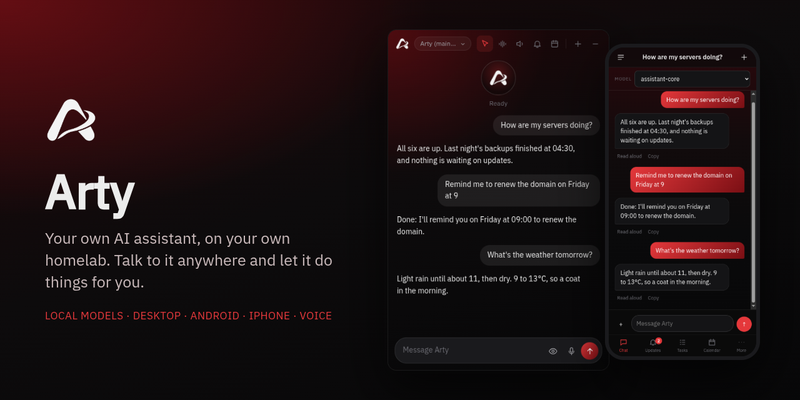

<div align="center">



# Arty

**A self-hosted AI assistant that lives on your own homelab - talk to it from your PC, your phone, Telegram or Discord, and let it work on a computer of its own.**

[](https://www.python.org/)
[](https://ollama.com/)
[](https://kotlinlang.org/)
[](https://www.electronjs.org/)
[](https://www.proxmox.com/)
[](LICENSE)

</div>

---

## Overview

Arty is a personal assistant that runs entirely on your own hardware - the models, its memory, your chats and its
tools all stay at home. It's calm, practical and a bit dry, and it actually does things rather than explaining how
you could: it checks your servers, reads your email, keeps reminders and deadlines, sends a morning and evening
briefing, searches the web privately, and has its own virtual machine to browse and work on.

The brain runs `qwen3:14b` through Ollama on a 12 GB GPU, and everything else - the desktop app, the phone apps, the
voice assistant, the chat bots - talks to it through one API. Every app asks for your own server's address on first
start, so nothing is tied to anyone else's homelab.

This repository is the brain, with everything that connects to it in its own folder. Each part has its own README
covering how to install it, how to use it, and what it's been run and tested on.

---

## Requirements

- **A Proxmox VE 9 host.** `provision.sh` and `deploy.sh` drive it over SSH with `pct` and `qm`.
- **A Debian 13 LXC container for the brain** with nesting on (SearXNG runs in Docker inside it), about 6 GB of RAM
  and a GPU passed through. Built and tested on an NVIDIA RTX 3060 (12 GB); `qwen3:14b` fills it. A smaller card runs a
  smaller model with fewer tools per request. A bigger card can run a bigger model: any Ollama model that supports tool
  calling works as the main model, and models over 16B are shown every tool at once (`tool_budget_by_size` in
  `brain/brain.json`). A 27B to 32B model at 4-bit, such as `qwen3:32b`, needs roughly 20 GB of VRAM, so a 24 GB card;
  only `qwen3:14b` has been tested. Set `vram_budget_mb` in `brain/brain.json` to a little under your card's memory
  (11500, the default, suits 12 GB; about 23000 suits 24 GB): before a picture or a handed-off job loads a second
  model, Arty unloads the others if together they would go over it.
- **A Debian 13 VM with XFCE for Arty's own PC** - its browser, Gmail window, terminal and document library.
- **SSH from the machine you deploy from** to the Proxmox host as root (the SSH host name in `PROXMOX`, `proxmox` by
  default) and to Arty's PC (`DESKTOP`, `ai@<its address>`).
- Optional: Uptime Kuma, Nextcloud and PufferPanel for the homelab tools, a Cloudflare tunnel for the phone apps away
  from home, and a USB mic and speakers on the host for the voice assistant.

---

## How It Works

```
 Arty Desktop (your PC) ───────LAN─────────┐
 Arty for Android ───LAN or Cloudflare─────┤                       ┌─▶ Ollama or ArtyEngine (models, GPU)
 Arty for iPhone ────LAN or Cloudflare─────┤                       │
 Arty for Quest (beta) ─▶ voice server ────┼─▶ Brain (:8081) ──────┼─▶ Tool hub: memory, web search, homelab, ...
 Voice assistant ("Hey Arty") ─────────────┤                       │
 Telegram / Discord bots ──────────────────┘                       └─▶ Arty's PC (VM): browser, Gmail window, terminal
```

Everything talks to the brain through one API ([docs/API.md](docs/API.md)) with the Arty API key. At home the apps
use the brain's LAN address; away from home the phone apps go through a Cloudflare tunnel behind Cloudflare Access
([docs/cloudflare.md](docs/cloudflare.md)). Notifications - reminders, briefings, task results, approvals, homelab
alerts - only ever go to **Updates** in the phone and desktop apps.

The brain and its tool servers send their model requests to Ollama's API at `OLLAMA_URL` (`http://127.0.0.1:11434`
unless set). That can be Ollama itself or [ArtyEngine](https://github.com/drew-codes-things/ArtyEngine),
Arty's own Ollama-compatible server built on llama.cpp's `llama-server`. ArtyEngine reads the models already in Ollama's
store, so switching downloads nothing again, and its README covers installing it and moving Arty over and back.
ArtyEngine is a separate repository with a different licence: [PolyForm Strict 1.0.0](https://github.com/drew-codes-things/ArtyEngine/blob/main/LICENSE)
(noncommercial use, no sharing or changed versions), not Arty's Apache 2.0.

---

## What's In Here

| Folder | What it is |
|---|---|
| `brain/`, `mcp/`, `bin/`, `services/`, `tests/` | The brain - persona, memory, the model and tool loop, tasks, schedules, briefings, the Arty API and its MCP tool servers (this README) |
| [`arty-pc/`](arty-pc/) | Scripts for Arty's own computer - its browser agent, terminal, document reader and desktop look |
| [`apps/desktop/`](apps/desktop/) | Arty Desktop - voice, a small window and hands on your Linux PC, with the AppImage in `release/` |
| [`apps/android/`](apps/android/) | Arty for Android - chat, Updates, tasks, schedules and memory, with the APKs in `release/` |
| [`apps/ios/`](apps/ios/) | Arty for iPhone - a Home Screen web app, served by the brain at `/ios/` |
| [`apps/beta/quest/`](apps/beta/quest/) | **Beta.** Arty for Quest 3 and 3S, your own virtual reality AI - an orb and panels in passthrough, talking through the voice server |
| [**Arty CLI**](https://github.com/drew-codes-things/ArtyCode) | Arty in your terminal on Linux and Windows, its own repository (ArtyCode): reads, edits and runs code in your project, asking first. Runs on your Arty; `arty` starts it |
| [`apps/beta/code/`](apps/beta/code/) | **Beta, being replaced by Arty CLI.** Arty Code - the first terminal app |
| [`voice/`](voice/) | The room mic and speakers hub, and the "Hey Arty" voice assistant |
| [`extensions/gmail/`](extensions/gmail/) | Chrome extension that lets Arty's PC read your Gmail |
| [`extensions/browser/`](extensions/browser/) | Browser extension (Chrome, Edge, Brave, Chromium, Firefox) that lets Arty Desktop use your own browser |
| [`chat-bots/telegram/`](chat-bots/telegram/), [`chat-bots/discord/`](chat-bots/discord/) | Arty on Telegram and Discord, owner-only |
| `doclib/` | The docs library: official documentation (Python, MDN, Node.js, Rust, Go, Java, PostgreSQL, Docker, Git, Linux man pages, Proxmox, Debian and more) downloaded into a local search index that coding answers read first |
| `code-runner/` | The code runner: a small container that runs the code in Arty's coding answers in a fresh sandbox (no network, capped time and memory) so Arty can fix real errors before it answers |
| [`docs/`](docs/) | [The Arty API](docs/API.md), [linking everything through Cloudflare](docs/cloudflare.md), [connecting a phone](docs/connecting-a-phone.md) and [connecting a Quest headset](docs/connecting-a-headset.md) |

The beta apps are built and unit-tested. Arty for Quest has run on a real headset (it connects and shows its panels) but not every feature has been tried.
Arty CLI's Windows installer has been run on Windows 10 (PowerShell 5.1).

---

## Features

- **Local models** - runs on Ollama on your own GPU; switch models with one command or by asking.
- **Real actions, checked in code** - email, calendar, reminders, deadlines, dates, sums, units, currency and server
  status are handled by code before the model sees them, so the model can't make results up.
- **Honesty check** - a reply that claims it did something when no tool ran (or every tool failed) is replaced with
  what really happened.
- **Briefings** - a morning and evening summary built from your real servers, weather, calendar, reminders,
  deadlines and email, with empty sections left out.
- **Its own PC** - a Debian + XFCE virtual machine with a visible browser, a shared terminal you can watch, a
  searchable `~/library` of documents, and a desktop look it picks itself.
- **Approvals** - anything that sends, buys, deletes or touches the homelab, or installs software on Arty's PC, waits
  for your Approve / Deny.
- **Checked coding answers** - code questions read the matching section of the local docs library (or the web) first,
  the code comes back in the reply, and with the optional code runner it is run in a sandbox and fixed before you see it.
- **Safe browsing** - logins, CAPTCHAs and bot checks are reported back to you, never got around.
- **Everywhere** - desktop app, Android, iPhone and Quest (beta: your own virtual reality AI), voice, Telegram and Discord, all sharing one memory.
- **Works with [starfire.ai](https://github.com/drew-codes-things/starfire.ai)** - add Arty to starfire as an
  OpenAI-compatible provider and chat with it in the browser, next to your plain Ollama models.
  starfire.ai is getting its own update too: a cleaner look with every control styled in both themes, and
  the layout and features of the big chat apps (chat history in a sidebar, a Stop button, copy, edit and
  regenerate on messages, code blocks with a Copy button, renaming and searching chats, tabbed settings and
  keyboard shortcuts).

---

## Arty, Arty CLI and starfire.ai

These three projects are made to work together, and each one links to the other two.

| Project | What it is | What it does for the other two |
|---|---|---|
| [Arty](https://github.com/drew-codes-things/Arty) | The assistant: the brain and its API, tools, memory and voice, plus the desktop, Android, iPhone and Quest apps | Answers for both. Arty CLI and starfire.ai send their chats to Arty's API and use its models and tools. Arty's approve page sends a browser that has no Arty key to starfire.ai |
| [Arty CLI](https://github.com/drew-codes-things/ArtyCode) (ArtyCode) | Arty in your terminal: a coding agent that reads, edits and runs code in a project, asking first | Talks only to Arty. Logs in with an Arty API key, or by approving the computer in the browser. With `/remote` it shares a session through Arty, so starfire.ai and the Arty phone apps can follow and steer it |
| [starfire.ai](https://github.com/drew-codes-things/starfire.ai) | A web chat dashboard for local and hosted models | Lets you chat with Arty in the browser. Its admin-only **Arty devices** page approves a computer that is logging in (Arty CLI's browser login), lists and turns off approved devices, chooses which devices may control Arty CLI, and makes a new key with a QR code for a phone. Its admin-only **Arty CLI** page follows and steers shared Arty CLI sessions |

How to link them:

- **Arty to starfire.ai**: set `BRAIN_STARFIRE_URL` in the brain's `brain.env` to starfire's address, so the approve
  page can send people there.
- **starfire.ai to Arty**: add Arty under **Settings > Connections** with its address and API key, and set
  `ARTY_BASE_URL` in starfire's `.env` to exactly the same address (the **Arty devices** page needs it).
  `ARTY_PHONE_URL`, `ARTY_ACCESS_CLIENT_ID` and `ARTY_ACCESS_CLIENT_SECRET` are optional, for phone setup codes that
  work away from home.
- **Arty CLI to Arty**: set `ARTY_URL` (home network) or `ARTY_REMOTE_URL` (from anywhere, with
  `ARTY_ACCESS_CLIENT_ID` and `ARTY_ACCESS_CLIENT_SECRET` if Cloudflare Access guards it), then run `arty login`.

- **Controlling Arty CLI from elsewhere**: run `/remote` (or start with `arty --remote`) on the computer. Open
  **Arty CLI** in starfire's sidebar, or **More > Computers** in the Android and iPhone apps. A phone with its own
  device key also needs **Arty CLI** switched on for it on starfire's **Arty devices** page; Arty's own key always
  may. Everything goes through Arty's brain (`/v1/remote/...`, see [docs/API.md](docs/API.md)).

Arty works without the other two. Arty CLI needs Arty. starfire.ai works with other models on its own, but its
**Arty devices** page needs Arty.

## Download

Everything to install is on the [Releases](../../releases) page:

| Download | What it is |
|---|---|
| `Arty-1.5.2-x86_64.AppImage` | [Arty Desktop](apps/desktop/README.md) for Linux |
| `Arty-Setup-1.5.2.exe` | [Arty Desktop](apps/desktop/README.md) for Windows 10 and 11 |
| `Arty-1.5.2.apk` | [Arty for Android](apps/android/README.md), which asks for your server on first start |
| `Arty-Browser-Extension-1.5.1.zip` | [Arty for Chrome](extensions/browser/README.md) for Chrome, Edge, Brave and Chromium: unzip it, then **Load unpacked** |
| `Arty-Browser-Extension-1.5.1.xpi` | The same extension for Firefox, not signed by Mozilla (see its README) |

> **On Linux, Arty Desktop works properly on Debian 13 with KDE Plasma. On Windows it targets Windows 10 and 11, and the installer is not code-signed, so SmartScreen asks you to confirm.**

The iPhone app needs no download: your own brain serves it at `/ios/`. The Quest app is built from source while it's
in beta. The brain itself is installed from this repository (below).

What changed lately: [release notes for 1.5.2](docs/release-notes-2026-11-13-1.5.2.md), and before that [1.5.1](docs/release-notes-2026-11-13-1.5.1.md).

---

## Setup

Set it up in this order. Steps 1 to 3 happen inside the brain's container (`pct enter <id>` on the host); the rest
run from the machine you cloned this repository to.

### 1. Install the software in the brain's container

```bash
apt update
apt install -y python3 python3-venv python3-requests pipx nodejs npm jq curl openssl docker.io
curl -fsSL https://ollama.com/install.sh | sh
```

Point Ollama at its own folder and keep models loaded, in `/etc/systemd/system/ollama.service.d/arty.conf`:

```ini
[Service]
Environment="OLLAMA_HOST=127.0.0.1:11434"
Environment="OLLAMA_MODELS=/srv/ai/ollama"
Environment="OLLAMA_KEEP_ALIVE=-1"
Environment="OLLAMA_KV_CACHE_TYPE=q8_0"
```

```bash
mkdir -p /srv/ai/ollama && chown ollama:ollama /srv/ai/ollama
systemctl daemon-reload && systemctl restart ollama
ollama pull qwen3:14b
ollama pull mimo-v2.6:9b
ollama pull nomic-embed-text
```

The tool hub and its MCP servers:

```bash
export PIPX_HOME=/opt/pipx PIPX_BIN_DIR=/usr/local/bin
pipx install mcp-server-fetch
pipx install mcp-server-time
npm install -g @modelcontextprotocol/server-memory @modelcontextprotocol/server-sequential-thinking
python3 -m venv /opt/ai-mcp && /opt/ai-mcp/bin/pip install "mcp==1.30.0" cryptography
python3 -m venv /opt/ai-hub && /opt/ai-hub/bin/pip install "mcp==2.3.0"
```

The tool hub (`hub/tool_hub.py`, run from `/opt/ai-hub`) starts every server in `mcp/tool-hub.json` with the official
MCP Python SDK and serves each tool to the brain over HTTP on 127.0.0.1:8000, behind `MCPO_API_KEY`. A server that
dies is started again. Tool servers get only the settings in their `env` plus a basic environment (`PATH`, `HOME`,
`USER`), never the hub's key. The fetch server's page reader needs Node 20 or newer.

### 2. Folders and keys

```bash
mkdir -p /srv/ai/brain/state /srv/ai/mcp /srv/ai/memory/conversations
install -d -m 700 /srv/ai/secrets
( umask 077
  printf 'MCPO_API_KEY=%s\n' "$(openssl rand -hex 24)" > /srv/ai/secrets/mcpo.env
  printf 'BRAIN_API_KEY=%s\n' "$(openssl rand -hex 24)" > /srv/ai/secrets/brain.env )
```

`provision.sh` adds the Arty API key (the one the apps use) and the alert token to `brain.env`, and writes them to
`/srv/ai/secrets/arty-api.txt`. Nothing in `/srv/ai/secrets` is ever printed.

### 3. Make it yours

Before the first deploy, in this repository:

| File | Change |
|---|---|
| `brain/brain.json` | `user_name` (what Arty calls you in its notes; it always talks to you as "you"), `weather` (your town and its latitude and longitude), `expiry_watch` (your domains and the sites whose certificates to watch), `vram_budget_mb` (if your GPU isn't 12 GB: a little under its memory in MB) |
| `brain/persona.md` | Who Arty is and how it talks. Add a paragraph about yourself and one or two things you've written so it can match your style |
| `mcp/tool-hub.json` | The time zone in `--local-timezone` |

Then put your server addresses in the files listed in [Your Own Servers](#your-own-servers).

### 4. Provision

Nothing about your network is built in. Copy `hosts.env.example` to `hosts.env` and put your own addresses in it
(it is read by `provision.sh` and `deploy.sh` and is never committed). The addresses in this guide are examples from
the range reserved for documentation, 192.0.2.0/24: replace them with yours. Then, from this repository:

```bash
cp hosts.env.example hosts.env      # then edit it
CT=104 DESKTOP_VMID=105 TIMEZONE=Europe/London ./provision.sh
```

You can also pass `AI_ADDRESS`, `DESKTOP_ADDRESS`, `HOST_ADDRESS` and `NETWORK` on the command line instead. The
scripts stop and say which one is missing.

It's safe to re-run. It installs the tools on Arty's PC, makes a Proxmox user that can read status everywhere and
snapshot only Arty's PC, starts SearXNG and the HTTPS proxy, sets up the host's daily facts and security watch, picks
the GPU at every boot, installs the speech-to-text tools and makes the Arty API key.

| Setting | What it does | Leave unset to |
|---|---|---|
| `CT`, `DESKTOP_VMID` | The brain's container and Arty's PC | use 104 and 105 |
| `AI_ADDRESS`, `DESKTOP_ADDRESS` | Their LAN addresses (required) | stop and ask for them |
| `HOST_ADDRESS`, `NETWORK` | The Proxmox host and your LAN, for the security watch (required) | stop and ask for them |
| `HEAL_GUESTS` | Guests Arty may start or restart after you tap Fix (ids, space separated) | give it none |
| `NEXTCLOUD_CT` | The container running Nextcloud in Docker, for Arty's own account | skip it |
| `HOST_FACTS_FILE` | The file on the Proxmox host that the brain's container sees as `/srv/ai/state/host-facts.json` (updates waiting and last backups, for the weekly report) | skip the daily host facts |
| `BACKUP_JOB` | The id of a vzdump job in `/etc/pve/jobs.cfg` to add the brain and Arty's PC to. Nothing else in that job, and no other job, is changed | leave every backup job alone |
| `SET_BACKUP_JOBS` | `no` skips the backup step even when `BACKUP_JOB` is set | add them to `BACKUP_JOB` |
| `TIMEZONE` | The container's time zone | use Europe/London |

Any of these can also go in `hosts.env`.

### 5. Deploy

```bash
CT=104 ./deploy.sh
```

It copies the brain, the tool servers, the iPhone app and the services to the container, the scripts to Arty's PC,
and restarts everything. It keeps whichever main model is live. If your chat bots run in PufferPanel, set
`ARTY_DISCORD_ID` and `ARTY_TELEGRAM_ID` (their PufferPanel server ids) and `PUFFER_DIR` (PufferPanel's servers folder
on the Proxmox host) in `hosts.env`; left empty, the bots are skipped. Run it again after every change.

It also installs the docs library (`doclib/` in `/srv/ai/doclib`, the `docs-library` service on port 8889, answering
only the container itself and its Docker network) and a timer that refreshes it every Sunday at 04:30. The library
starts empty: build it once with `pct exec 104 -- systemctl start docs-library-refresh`, which downloads the
documentation and builds the index in `/srv/ai/docs-library` (about 750 MB; it downloads nothing while less than 8 GB
is free). Until then coding questions read the web as before. On a new server `provision.sh` also adds the library to
SearXNG as the `local docs` engine; it leaves an existing `/srv/ai/searxng/settings.yml` alone.

Check it's up:

```bash
pct exec 104 -- systemctl is-active ollama tool-hub brain docs-library
pct exec 104 -- cat /srv/ai/secrets/arty-api.txt
```

### 6. Arty's PC

Follow [arty-pc/README.md](arty-pc/README.md) to sign Arty's browser in to the sites it should use, then install the
[Gmail extension](extensions/gmail/README.md) in it.

### 7. Your devices

| App | First start |
|---|---|
| [Arty Desktop](apps/desktop/README.md) | Asks for the brain's address (`http://<AI_ADDRESS>:8081/v1`) and the API key, and optionally the Cloudflare address and Access token. **Connect to another Arty…** in the tray menu changes them |
| [Arty for Android](apps/android/README.md) | Install `Arty-1.5.2.apk`; it asks for the same details and keeps them encrypted on the phone |
| [Arty for iPhone](apps/ios/README.md) | Open `https://<your address>/ios/` in Safari and add it to the Home Screen; it asks for the API key. It also approves new computers, and More > **Approved devices** lists and turns them off |
| [Arty for Quest](apps/beta/quest/README.md) (beta) | Asks for the voice server's headset address and key |
| [Arty CLI](https://github.com/drew-codes-things/ArtyCode) | `./install.sh` (Debian) or `install.ps1` (Windows) from the ArtyCode repository, then `arty login`: an Arty API key, or approving the computer in your browser |
| [Arty Code](apps/beta/code/README.md) (beta, being replaced) | `pipx install ./apps/beta/code`, then `arty-code setup` asks for the same details as Arty Desktop |
| [Arty for Chrome](extensions/browser/README.md) | Lets Arty Desktop use your own browser: Chrome, Edge, Brave, Chromium or Firefox |

Away from home, the phone apps need [the Cloudflare link](docs/cloudflare.md). To set a phone up, scan the QR code
from Arty Desktop's tray menu > **Phone setup code…**, or type the details in
([docs/connecting-a-phone.md](docs/connecting-a-phone.md)).

### 8. Optional

- [Voice](voice/README.md): the room mic and speakers hub, "Hey Arty", and the Quest headset socket.
- The [Telegram](chat-bots/telegram/README.md) and [Discord](chat-bots/discord/README.md) bots.
- Code checking: make a small Debian container, put its id in `hosts.env` as `RUNNER_CT`, run
  `code-runner/deploy.sh setup` while it still has internet, then `code-runner/deploy.sh firewall` (only `AI_ADDRESS`
  can reach it afterwards; take its gateway away too). Set `CODE_RUNNER_URL=http://<runner address>:8790` in
  `/srv/ai/secrets/brain.env` and run `systemctl restart brain`. Coding answers then end with a "Sandbox check:" line.
  When an answer shows what its code prints, Arty compares that with what the code really printed in the sandbox and
  fixes the answer if they differ (output that depends on time, randomness or input is left alone).
- Homelab tools: put the keys in `/srv/ai/secrets/homelab.env` (Uptime Kuma: `UPTIME_KUMA_API_KEY`, created under
  Settings > API Keys) and run `systemctl restart tool-hub brain`.

---

## Your Own Servers

Every address is a setting and none is built in. The brain's own links, the chat bots and the voice assistant assume
everything runs on the same machine (127.0.0.1) until you tell them otherwise, and a homelab service whose address
is not set (Proxmox, Uptime Kuma, Nextcloud, PufferPanel, Arty's PC) simply says it is not set up. Set the ones you use:

| Setting | Where | Used for |
|---|---|---|
| `BRAIN_PUBLIC_URL` | `/srv/ai/secrets/brain.env` | The brain's own address in links it hands out |
| `BRAIN_FILES_URL` | `/srv/ai/secrets/brain.env` | The HTTPS address that serves files Arty makes for you |
| `WORKSPACE_HOST` | `/srv/ai/secrets/workspace.env` (its own file: tool servers start with a minimal environment) | Arty's PC |
| `PVE_URL` | `/srv/ai/secrets/homelab.env` | The Proxmox API |
| `UPTIME_KUMA_URL`, `UPTIME_KUMA_API_KEY` | `/srv/ai/secrets/homelab.env` | Server status |
| `NEXTCLOUD_URL` | `/srv/ai/secrets/homelab.env` | Nextcloud |
| `PUFFERPANEL_URL`, `PUFFERPANEL_CLIENT_ID`, `PUFFERPANEL_CLIENT_SECRET` | `/srv/ai/secrets/homelab.env` | Game servers |
| `CALENDAR_TIMEZONE` | `/srv/ai/secrets/brain.env` | Your calendar's time zone |
| `HOMELAB_NAMES` | `/srv/ai/secrets/brain.env` | Comma-separated names of your Proxmox host and guests: a message naming one gets the server status looked up first |
| `BRAIN_TRUSTED_PROXIES` | `/srv/ai/secrets/brain.env` | Comma-separated addresses of the proxy in front of the brain (the Cloudflare tunnel's machine), the only ones whose `Cf-Connecting-Ip` is believed |
| `BRAIN_STARFIRE_URL` | `/srv/ai/secrets/brain.env` | starfire's address (for example `https://<STARFIRE_ADDRESS>`). When a computer asks to be approved in a browser with no Arty key, the approve page links to starfire's Arty devices page with a QR code. Leave it out and the page only offers pasting a key |
| `BRAIN_URL`, `HUB_URL` | the voice assistant's environment | The brain and the voice hub ([voice/](voice/README.md)) |
| `BRAIN_URL` | each chat bot's environment | The brain ([chat-bots/](chat-bots/)) |

Restart with `systemctl restart tool-hub brain` after changing them.

---

## Using It

- **Chat**: any of the apps, or your own code through [the Arty API](docs/API.md).
- **In the browser**: [starfire.ai](https://github.com/drew-codes-things/starfire.ai) works with Arty. In starfire,
  Settings → Connections → "Add API provider" → "Other (OpenAI-compatible)", with the brain's address
  (`http://<AI_ADDRESS>:8081/v1`) and `ARTY_API_KEY`, then pick `Arty` (the main model; the old name `assistant-core` still works).
- **Models**: on the brain's container, `ai-pull <model>` downloads one (no arguments: suggestions), `ai-models`
  lists them and `ai-use <model>` switches Arty's main model. Or tell Arty "switch to <model>" in any app; only models
  in `arty_models` in `brain.json` are accepted. Only models that can use tools can run Arty, unless you run
  `ai-toolless on`. Hugging Face GGUFs work too: `ai-pull hf.co/<user>/<repo>:Q4_K_M`.
- **Pictures**: `vision_model` in `brain.json` names the model that looks at pictures (`mimo-v2.6:9b`). If it isn't
  downloaded, the first downloaded Arty model that can see is used (never a solo model). The main model and the vision
  model don't fit on the 12 GB card together, so with `route_picture_chats` (on by default) a chat with plain `Arty`
  that brings a new picture is answered by the vision model too, when it can use tools, instead of swapping the main
  model back in for the answer. A picture uploaded through the apps starts the vision model loading while you type.
  Set it to `false` to keep picture answers on the main model.
- **Picking a model per job**: Arty CLI's agent mode runs on `coding_model` (`qwen3:14b`, the main model). For
  anything else the main model can hand a job to another model in `arty_models` with `ask_other_model`;
  `model_strengths` says what each one is best at. A model that isn't downloaded is never picked: Arty falls back to
  the coding model in agent mode, or the main model, and logs it.
- **Coding questions in chat**: `route_coding_chats` in `brain.json` (on by default when `coding_model` is set) sends a
  chat to `coding_model` when it picks plain `Arty` and is clearly about code: a fenced code block, a pasted traceback or
  compiler error, or asking to write, fix, debug, refactor, review or explain code, a script, a regex, a SQL query or a
  shell command. A short question only moves when the coding model is already loaded; a long paste, a whole app or a
  change across a project always does, so a quick question doesn't cost two model swaps. Every app gets it with no update, the reply still comes from Arty, and the main model is loaded again
  200 seconds later. A model picked by name, solo models and the private add-on are never moved; if the coding model
  isn't downloaded, the main model answers and the brain logs it. Set it to `false` to keep every chat on the main model.
  As shipped, `coding_model` is the main model, so coding chats stay on it; pictures still go to the vision model. A coding
  question gets its code in the reply: Arty doesn't write it to a file or run it, on its PC or yours, unless you ask it
  to run, test, save, install or build it.
- **Models on their own**: anything listed in `solo_models` in `brain.json` shows up in the apps' model pickers as a
  plain chat, with no Arty persona, tools or memory.
- **Approvals**: in chat Arty asks and acts when you say yes; for background tasks, Updates in the phone and desktop
  apps shows Approve and Deny. The rules are under `approval` in `brain.json`.
- **Documents**: put files in `~/library` on Arty's PC (or ask Arty to) and `search_library` finds them by meaning.
- **Changing how it behaves**: personality in `brain/persona.md`, instructions in `brain/system-prompt.md`, settings
  in `brain/brain.json` (in `/srv/ai/brain` on the container). Changes apply on the next message.
- **Memory**: each message gets the saved facts that match its words first, then the newest facts, up to 4,000
  characters. Every night at 04:00 a tidy-up moves facts saved twice, and facts a later fact replaces (a new address,
  a new job), out of memory into `/srv/ai/memory/archived-facts.jsonl`, with the reason. Nothing is deleted: say "undo
  the memory tidy-up" to put the last night's facts back. `memory_tidy` in `brain.json` takes `"enabled": false` or
  another `"hour"`.
- **Where things live**: memory in `/srv/ai/memory/memory.json`, past chats in `/srv/ai/memory/conversations/`,
  tasks and schedules in `/srv/ai/brain/state/arty.db`.

### Safety

- The Proxmox token reads status everywhere and can only snapshot Arty's PC. Background tasks snapshot the PC before
  using it (the newest 3 are kept; roll back in Proxmox > the VM > Snapshots).
- Pages with logins, CAPTCHAs or bot checks are reported as blocked and Arty asks you instead of getting around them.
- Secrets live in `/srv/ai/secrets` (root-only) and are never printed by the scripts.

---

## Limitations

Know these before relying on it:

- **It can still be wrong** - outside the things handled in code, it can misunderstand a request, pick the wrong
  tool or state something false with confidence. Check anything important, and read commands before running them.
- **Speed** - `qwen3:14b` writes about 33 tokens a second on an RTX 3060. Replies usually start within a few
  seconds, but the first message after the model has unloaded, or one that needs a new group of tools, can take
  20-50 seconds.
- **Short memory within a chat** - 24,576 tokens of context, so long chats are trimmed. Older chats and saved facts
  are recalled by search, and it can miss details.
- **One model on the GPU at a time** - looking at an image swaps the vision model in for that one look, then the main
  model loads back in the background (about a minute in all).
- **Limited actions** - email is read-only, through a signed-in Gmail window; it can't send it. It can't create VMs
  or change the homelab on its own, and installing software on its own PC (sudo, apt, global npm or pip installs and
  the like) waits for your approval.
- **Home network for most things** - away from home only the phone apps work (through Cloudflare). Arty Desktop,
  voice and the chat bots need the LAN, and nothing works while the brain's container is off. There's no cloud
  fallback.
- **One person** - it's built for a single owner; the bots and apps don't do multiple users.

---

## Tested On

| Part | Ran and tested on |
|---|---|
| Brain | Proxmox VE 9.2.21 (kernel 7.0.14-25-pve), LXC container on Debian 13 (trixie), Python 3.13.5, Ollama 0.40.16 with `qwen3:14b` on an NVIDIA RTX 3060 (12 GB, CUDA), the tool hub on mcp 2.3.0 with tool servers on mcp 1.30.0, SearXNG |
| Everything else | See each part's own README |

## Test Results

### Speed on the RTX 3060 (12 GB)

| Model | Context | Writing speed | Placement |
|---|---|---|---|
| qwen2.5:3b | - | about 120 tok/s | 100% GPU |
| qwen2.5:7b | 16k | 65 tok/s | 100% GPU, with qwen2.5vl:7b loaded too |
| qwen3:14b | 8k | 33 tok/s | 100% GPU (10 GB) |
| qwen3:14b | 12k | 33 tok/s | 100% GPU (11 GB) |
| qwen3:14b | 16k | 22 tok/s | 9% spills onto the CPU (12 GB) |
| qwen3:14b, q8_0 context cache | 12k | 29.6 tok/s | 100% GPU (9.8 GB, cache 1,020 MB instead of 1,920 MB) |
| qwen3:14b, q8_0 context cache | 24k | 28.6 tok/s | 100% GPU (10.8 GB) |
| qwen3:14b, q8_0 context cache | 32k | - | 11% spills onto the CPU |
| mimo-v2.6:9b | - | 53.4 to 53.9 tok/s | 100% GPU (6.6 GB) |

### qwen2.5:7b and qwen3:14b, same prompts

| Test | qwen2.5:7b | qwen3:14b |
|---|---|---|
| Apples puzzle | Muddled: said "10 apples", then worked out 7 | 7, clean working |
| Film end time (19:50 + 2h47) | Long, cut off before answering | 22:37, correct |
| "How's my server?" with a tool available | Said it would check, but never called the tool | Called the tool straight away |
| Code one-liner | Fine but wordy | Fine and tight |
| Thinking mode on | n/a | 7, in 11 s |

### qwen3:14b weak spots, and what fixed them

A full run of 17 test questions passed 16; everything left over passed when re-tested after these fixes.

| Weak spot | Before | After |
|---|---|---|
| Dates ("days until Christmas", "what day is 14 Feb 2027", Easter, "90 days from today") | 25-80 s, sometimes wrong | Under 2 s, exact: worked out in code first |
| Currency | Web search, no number | ECB exchange rate, about 4 s |
| Units (F to C, miles to km, pints) | Grabbed the time-zone tool | `convert_units` |
| Sums and percentages | Did them in its head | `calculate` |
| Clock maths (film end times) | OK | `clock_maths` for exactness |
| "Write me a command" | Ran it instead of writing it | Gives just the code; "...and run it" runs it |
| All 65 tools offered at once | About 10,500 tokens of tool descriptions in what was then a 12,288-token context (24,576 now) | Capped at 40 tools per message, about 5,000 tokens |

### The honesty check, judged by qwen3:14b

| Test | Result |
|---|---|
| "All sorted, the living room lights are on now" with no tool run | Corrected to say it didn't turn them on |
| Same, in Spanish ("Tu recordatorio está listo para las 18:00") | Corrected, in Spanish |
| "Kuma is back up and running" after the restart tool failed | Corrected, giving the permission error |
| A desktop description after `look_at_desktop` | Left alone |
| "I've opened the page" after the browser really opened it | Wrongly flagged, so the check now only runs when no action tool worked or one failed |
| A plain answer ("Paris is the capital of France") | Left alone, in 0.4 s |

### Running the tests

```bash
cd brain && python3 -m unittest discover -s tests
(cd hub && /opt/ai-hub/bin/python -m unittest discover -s tests)   # needs mcp 2
python3 -m pytest -q mcp voice/tests tests arty-pc chat-bots   # needs pytest, mcp, aiohttp, bcrypt, numpy, webrtcvad-wheels
(cd downloads && python3 -m unittest discover -p 'test_*.py')
(cd code-runner && RUNNER_URL=http://<runner address>:8790 python3 -m unittest discover -s tests)   # live tests skip without RUNNER_URL
ARTY_URL=http://<AI_ADDRESS>:8081/v1 ARTY_KEY=... python3 tests/e2e_battery.py   # scored eval against the live brain, see --help
cd apps/ios && node --test tests/
```

Each app's README has its own.

---

## License

[Apache License 2.0](https://www.apache.org/licenses/LICENSE-2.0) - see [LICENSE](LICENSE) and [NOTICE](NOTICE). You
can use, change and share Arty, including commercially; if you share it or anything built from it, keep the LICENSE and
NOTICE files, which credit Arty's author, and say what you changed.

The parts of Arty Desktop adapted from MIT-licensed projects stay under MIT, see
[apps/desktop/NOTICE](apps/desktop/NOTICE).

Made by [drew-codes-things](https://github.com/drew-codes-things)
