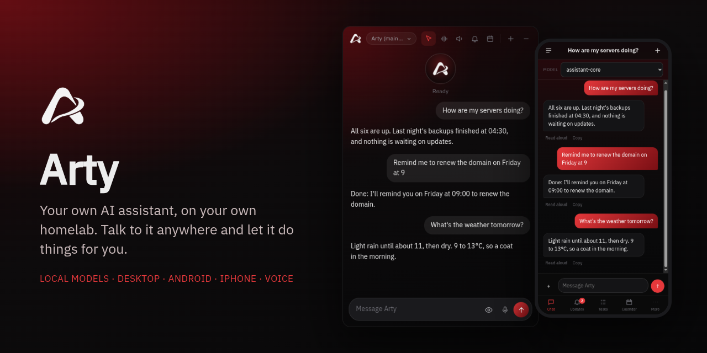

# Arty

**A self-hosted AI assistant that lives on your own homelab - talk to it from your PC, your phone, Telegram or Discord, and let it work on a computer of its own.**

---

## Contents

- [What Arty is](#what-arty-is)
- [The parts](#the-parts)
- [Download](#download)
- [Quick start](#quick-start)
- [What it can do](#what-it-can-do)
- [Limitations](#limitations)
- [Documentation](#documentation)
- [License](#license)

---

## What Arty is

Arty is a personal assistant that runs entirely on your own hardware - the models, its memory, your chats and its
tools all stay at home. It's calm, practical and a bit dry, and it actually does things rather than explaining how
you could: it checks your servers, reads your email, keeps reminders and deadlines, sends a morning and evening
briefing, searches the web privately, and has its own virtual machine to browse and work on.

The brain runs `qwen3:14b` on ArtyEngine, Arty's own model server, on a 12 GB GPU, and everything else - the desktop app, the phone apps, the
voice assistant, the chat bots - talks to it through one API. Every app asks for your own server's address on first
start, so nothing is tied to anyone else's homelab.

This repository is the brain, with everything that connects to it in its own folder. Each part has its own README
covering how to install it, how to use it, and what it's been run and tested on. How the parts fit together:
[how Arty works](docs/how-it-works.md).

---

## The parts

| Part | What it is | Status |
|---|---|---|
| [Brain](docs/setup.md) (`brain/`, `mcp/`, `bin/`, `services/`) | Persona, memory, the model and tool loop, tasks, schedules, briefings, the Arty API and its MCP tool servers | Installed from this repository |
| [Arty Desktop](apps/desktop/README.md) for Linux | Voice, a small window and hands on your Linux PC | Released: AppImage |
| [Arty Desktop](apps/desktop/README.md) for Windows | The same app for Windows 10 and 11 | Released: installer |
| [Arty for Android](apps/android/README.md) | Chat, Updates, tasks, schedules and memory | Released: APK |
| [Arty for iPhone](apps/ios/README.md) | A Home Screen web app, served by the brain at `/ios/` | Nothing to download |
| [Arty for your browser](extensions/browser/README.md) | Lets Arty Desktop use your own browser (Chrome, Edge, Brave, Chromium, Firefox) | Released: 1.5.1 |
| [Arty for Quest](apps/beta/quest/README.md) | **Beta.** Your own virtual reality AI, an orb and panels in passthrough | Built from source |
| [Arty CLI](https://github.com/drew-codes-things/ArtyCode) | Arty in your terminal on Linux and Windows, its own repository (ArtyCode) | Own repository |
| [Arty Code](apps/beta/code/README.md) | **Beta, being replaced by Arty CLI.** The first terminal app | Built from source |
| [Voice](voice/README.md) | The room mic and speakers hub, and the "Hey Arty" voice assistant | Installed from this repository |
| [Telegram](chat-bots/telegram/README.md) and [Discord](chat-bots/discord/README.md) bots | Arty in chat apps, owner-only | Installed from this repository |
| [Arty's PC](arty-pc/README.md) | Scripts for Arty's own computer: its browser agent, terminal, document reader and desktop look | Installed from this repository |
| [Gmail Reader](extensions/gmail/README.md) | Chrome extension that lets Arty's PC read your Gmail | Installed from this repository |
| `doclib/` and `code-runner/` | The docs library and the sandboxed code runner behind checked coding answers | Installed from this repository |

The beta apps are built and unit-tested. Arty for Quest has run on a real headset (it connects and shows its panels) but not every feature has been tried.
Arty CLI's Windows installer has been run on Windows 10 (PowerShell 5.1).

Every folder, with what it holds: [what is in the repository](docs/repository-layout.md). Arty, Arty CLI and starfire.ai work
together: [how to link them](docs/arty-cli-and-starfire.md).

---

## Download

Everything to install is on the [Releases](../../releases) page. The latest release is **Arty 1.7.0**
([release notes](docs/release-notes-2026-11-26-1.7.0.md)):

| Download | What it is |
|---|---|
| `Arty-1.7.0-x86_64.AppImage` | [Arty Desktop](apps/desktop/README.md) for Linux |
| `Arty-Setup-1.7.0.exe` | [Arty Desktop](apps/desktop/README.md) for Windows 10 and 11 |
| `Arty-1.7.0.apk` | [Arty for Android](apps/android/README.md), which asks for your server on first start |
| `Arty-Browser-Extension-1.8.zip` | [Arty for your browser](extensions/browser/README.md) for Chrome, Edge, Brave and Chromium: unzip it, then **Load unpacked** |
| `Arty-Browser-Extension-1.8.xpi` | The same extension for Firefox, not signed by Mozilla (see its README) |

> **On Linux, Arty Desktop works properly on Debian 13 with KDE Plasma. On Windows it targets Windows 10 and 11, and the installer is not code-signed, so SmartScreen asks you to confirm.**

The iPhone app needs no download: your own brain serves it at `/ios/`. The Quest app is built from source while it's
in beta. The brain itself is installed from this repository (see the quick start).

**New in 1.6.0:** Arty Desktop 1.6.0 and the browser extension 1.7 let Arty use a named browser ("open the BBC in
Firefox"), add Opera and Vivaldi, connect browsers and starfire Desktop without a code, give Arty a browser of its own,
let it control the screen when you turn that on (asking before every message it sends), and help with general
quizzes. The pages that describe them:
[Arty's own browser, screen control and quizzes](docs/desktop-control.md) and
[Linking Arty Desktop to starfire Desktop](docs/desktop-starfire-link.md).

Earlier release notes: [all releases](docs/README.md#release-notes).

---

## Quick start

You need a Proxmox VE 9 host, a Debian 13 container for the brain with a GPU passed through (built and tested on an
NVIDIA RTX 3060 with 12 GB) and a Debian 13 VM with XFCE for Arty's own PC. The full list is in
[requirements](docs/setup.md#requirements). Then, in this order:

1. [Install the software](docs/setup.md#1-install-the-software-in-the-brains-container) in the brain's container: Python, Node, Docker, [ArtyEngine](https://github.com/drew-codes-things/ArtyEngine), the models and the tool hub.
2. [Make the folders and keys](docs/setup.md#2-folders-and-keys) the brain reads its secrets from.
3. [Make it yours](docs/setup.md#3-make-it-yours): your name, town, time zone and GPU size in `brain/brain.json`, `brain/persona.md` and `mcp/tool-hub.json`.
4. [Provision](docs/setup.md#4-provision): copy `hosts.env.example` to `hosts.env`, put your own addresses in it, run `./provision.sh`.
5. [Deploy](docs/setup.md#5-deploy): `CT=104 ./deploy.sh`, again after every change.
6. [Arty's PC](docs/setup.md#6-artys-pc): sign its browser in to the sites it should use.
7. [Your devices](docs/setup.md#7-your-devices): install the desktop, Android or iPhone app and connect it ([phone setup](docs/connecting-a-phone.md); away from home, [Cloudflare](docs/cloudflare.md)).
8. [Optional](docs/setup.md#8-optional): voice, the chat bots, the code runner and the homelab tools.

Every address is a setting and none is built in: [your own servers](docs/setup.md#your-own-servers).
Once it runs, [using Arty](docs/using-arty.md) covers models, pictures, approvals, documents and memory.

---

## What it can do

- **Local models** - runs on ArtyEngine on your own GPU; switch models with one command or by asking.
- **Real actions, checked in code** - email, calendar, reminders, deadlines, dates, sums, units, currency and server
  status are handled by code before the model sees them, so the model can't make results up.
- **Honesty check** - a reply that claims it did something when no tool ran (or every tool failed) is replaced with
  what really happened.
- **Briefings** - a morning and evening summary built from your real servers, weather, calendar, reminders,
  deadlines and email.
- **Its own PC** - a Debian + XFCE virtual machine with a visible browser, a shared terminal you can watch and a
  searchable document library.
- **Approvals** - anything that sends, buys, deletes or touches the homelab, or installs software on Arty's PC, waits
  for your Approve / Deny.
- **Everywhere** - desktop app, Android, iPhone and Quest (beta), voice, Telegram and Discord, all sharing one memory.

The whole list, including checked coding answers, safe browsing and starfire.ai: [features](docs/features.md).

---

## Limitations

It can still be wrong outside the things handled in code, so check anything important. It writes about 33 tokens a
second on an RTX 3060, keeps 24,576 tokens of context in a chat, runs one model on the GPU at a time, needs the home
network for most things, and is built for a single owner. Email is read-only. The details: [limitations](docs/limitations.md).

**Model size:** use a main model of about 7B or above. Smaller models are easier to trick into the wrong action, so
Arty is not meant for them. Models from that size up are the recommended range; the ones it has been tested with are
`qwen3:14b` (the main model), `mimo-v2.6:9b` (code and pictures) and `qwen2.5vl:7b` (pictures). No model is immune
to a cleverly worded page or email, which is why Arty's approval checks stay on whichever model you use.

---

## Documentation

| | |
|---|---|
| [Setting up Arty](docs/setup.md) | Requirements, installing, provisioning, deploying, your own servers |
| [Using Arty](docs/using-arty.md) | Models, pictures, approvals, documents, memory, safety |
| [The Arty API](docs/API.md) | Every route for your own apps and code |
| [Connecting a phone](docs/connecting-a-phone.md), [a Quest headset](docs/connecting-a-headset.md) and [Cloudflare](docs/cloudflare.md) | Reaching Arty from your devices, and from away from home |
| [Everything else](docs/README.md) | How it works, features, limitations, tested on, trust boundary, release notes |

---

## License

[Apache License 2.0](https://www.apache.org/licenses/LICENSE-2.0) - see [LICENSE](LICENSE) and [NOTICE](NOTICE). You
can use, change and share Arty, including commercially; if you share it or anything built from it, keep the LICENSE and
NOTICE files, which credit Arty's author, and say what you changed.

The parts of Arty Desktop adapted from MIT-licensed projects stay under MIT, see
[apps/desktop/NOTICE](apps/desktop/NOTICE).

Made by [drew-codes-things](https://github.com/drew-codes-things)
